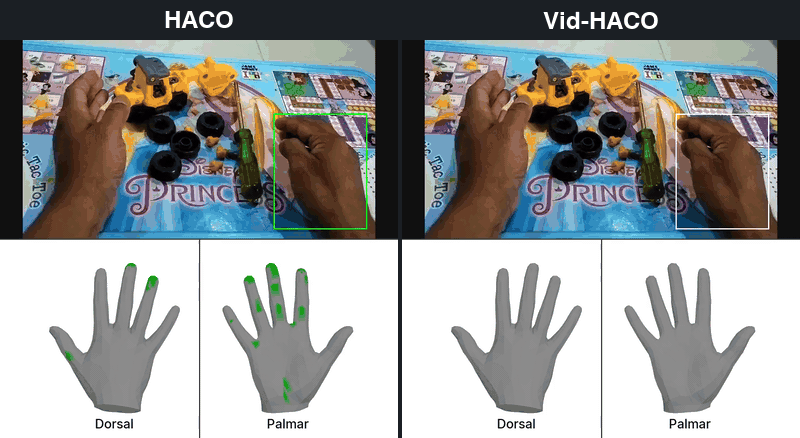
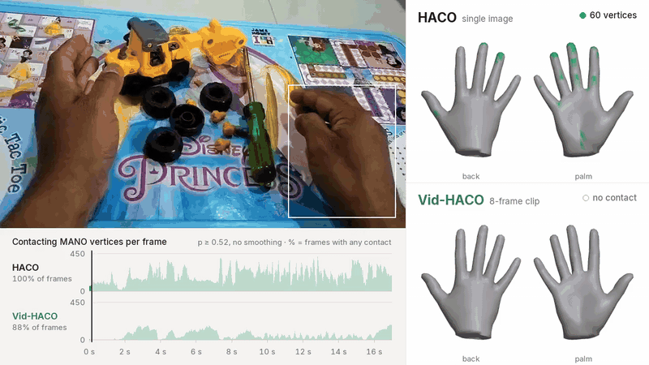
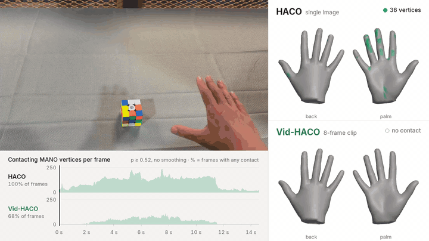
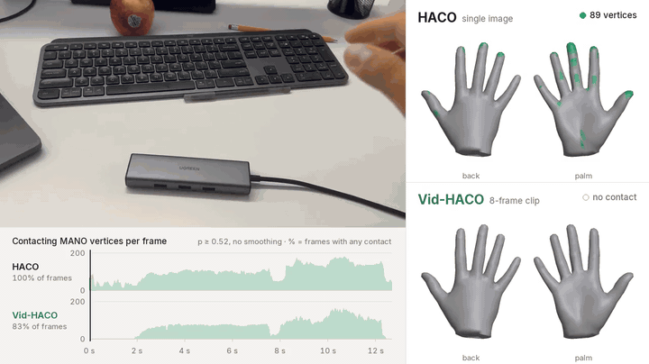
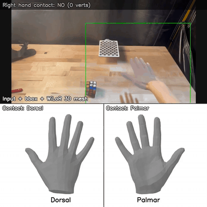
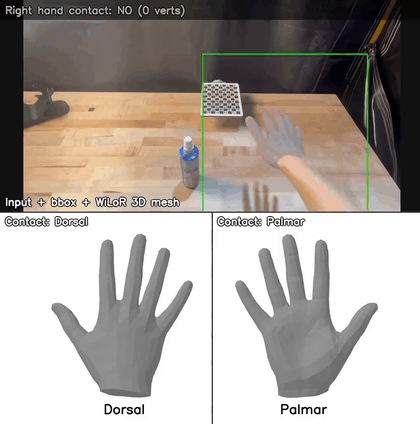
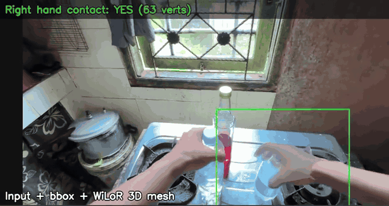
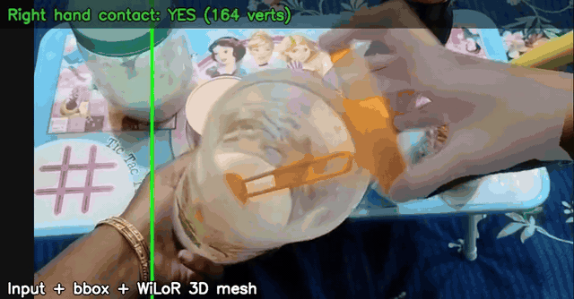
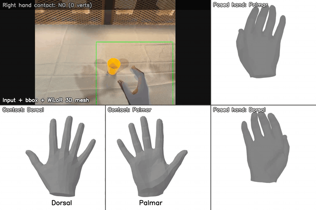

# Vid-HACO: dense hand contact estimation from video

Vid-HACO estimates **dense per-vertex hand contact** (778 MANO vertices) from video. It uses a pretrained
V-JEPA 2 video backbone and 8-frame clip input. It is trained on 12 datasets, including egocentric video
(HOT3D), allocentric ARCTIC views and EPIC-Contact.

<p align="center">
  
</p>

**HACO (left) vs. Vid-HACO (right)** on a toy-truck assembly clip: the hand box turns green on frames with
predicted contact. HACO reports contact on every frame, while Vid-HACO's contact drops each time the hand
lets go of one part to reach for the next.

## Demos

**HACO vs. Vid-HACO.** Both models see the same frames and hand crops, thresholded at 0.52 with no
smoothing. The plot counts contacting MANO vertices per frame: HACO, which reads single images, reports
contact on every frame, while Vid-HACO, which reads 8-frame clips, releases it when the hand is in the air
or lets go.

<!-- <p align="center">
  
</p> -->

<table>
  <tr>
    <td width="50%"></td>
    <td width="50%"></td>
  </tr>
</table>

**Vid-HACO on phone and in-the-wild videos.** Right-hand contact predicted by Vid-HACO, shown on the MANO hand
(back and palm).

<table>
  <tr>
    <td width="50%" align="center"><br>Rubik's cube</td>
    <td width="50%" align="center"><br>Spray bottle</td>
  </tr>
  <tr>
    <td align="center"><br>Kitchen, egocentric</td>
    <td align="center"><br>Jar and lid</td>
  </tr>
  <!-- <tr>
    <td colspan="2" align="center"><br><code>run.py</code> output (<code>--model vitl</code>): input with the tracked hand mesh, contact on the rest-pose hand (bottom left) and on the tracked pose (right)</td>
  </tr> -->
</table>

## Contents

| | |
|---|---|
| [`inference/`](inference) | video in, hand-contact video + per-frame predictions out (`run.py`) |
| [`data_processing/`](data_processing) | how the contact labels for all 12 training datasets are obtained, the unified loader, and the exact paper splits |
| [`training/`](training) | the trainer and the exact recipes behind `vith` and `vitl` (8-frame clips) |
| Checkpoints | not yet released — they need further legal approval and will be released once approved |

## Quick start (inference)

```bash
cd inference
cp config.env.example config.env               # point it at your two environments and HaWoR
./doctor.py                                     # checks environments, tracker, checkpoints, GPUs
./run.py --video my_clip.mp4 --out-dir out/my_clip --model vitl
```

> **Note:** The checkpoints need further legal approval and will be released once approved.

See [`inference/README.md`](inference/README.md) for setup (MANO, the HaWoR tracker, V-JEPA 2) and options.

## Models

| `--model` | best at | backbone | training | contact-map F1 | binary-contact F1 |
|---|---|---|---|---|---|
| `vitl` | **contact map estimation** — which of the 778 vertices are in contact | V-JEPA 2.1 ViT-L/384 + DPT | 12 datasets, 8-frame clips, epoch 6 | **0.791** | 0.985 |
| `vith` | **binary contact detection** — is the hand touching something | V-JEPA 2 ViT-H/256 + DPT | 8-frame clips, epoch 1 | 0.637 | **0.987** |

## Training data

| Dataset | Contact | View | Train | Val |
|---|---|---|---:|---:|
| HOT3D | object | ego | 643,980 | 71,792 |
| ARCTIC, allocentric | object | exo | 459,867 | 51,186 |
| ARCTIC, egocentric | object | ego | 168,343 | 18,707 |
| HOI4D | object | ego | 106,278 | 11,995 |
| DECAF | face | exo | 58,829 | 6,493 |
| Hi4D | body | exo | 49,902 | 5,306 |
| InterHand2.6M | hand | exo | 33,439 | 3,731 |
| H2O | object | ego | 30,117 | 3,350 |
| EPIC-Contact | object | ego | 2,035 | 237 |
| MOW | object | web | 307 | 43 |
| PROX | scene | exo | 157 | 21 |
| HIC | hand, object | exo | 99 | 16 |
| **Total** | | | **1,553,353** | **172,877** |

Datasets are not redistributed; see [`data_processing/README.md`](data_processing/README.md).

## Citation

If you use Vid-HACO, please cite [CARD](https://arxiv.org/abs/2610.36539)
([project page](https://card-retargeting.github.io/)):

```bibtex
@article{dai2026card,
    title = {CARD: Contact-Anchored Retargeting for Dexterous Manipulation},
    author = {Dai, Cunxi and He, Botao and Hogan, Francois R. and Pan, Wei and Fu, Rao and Hsieh, Wen-Han and Liu, Ruoshi and Malik, Jitendra and Shi, Guanya and Sharma, Akash},
    journal = {arXiv preprint arXiv:2610.36539},
    year = {2026}
}
```

## Acknowledgement

We thank the authors of these projects, whose code, data and models we use:

- [HACO](https://github.com/dqj5182/HACO_RELEASE)
- [V-JEPA 2](https://github.com/facebookresearch/vjepa2)
- [HaWoR](https://github.com/ThunderVVV/HaWoR)
- [WiLoR](https://github.com/rolpotamias/WiLoR)
- [MANO](https://mano.is.tue.mpg.de)

## Security

See [CONTRIBUTING](CONTRIBUTING.md#security-issue-notifications) for more information.

## Contributing

See [CONTRIBUTING](CONTRIBUTING.md) and our [Code of Conduct](CODE_OF_CONDUCT.md).

## License

The code in this repository is released under the **[Apache License 2.0](LICENSE)**.
